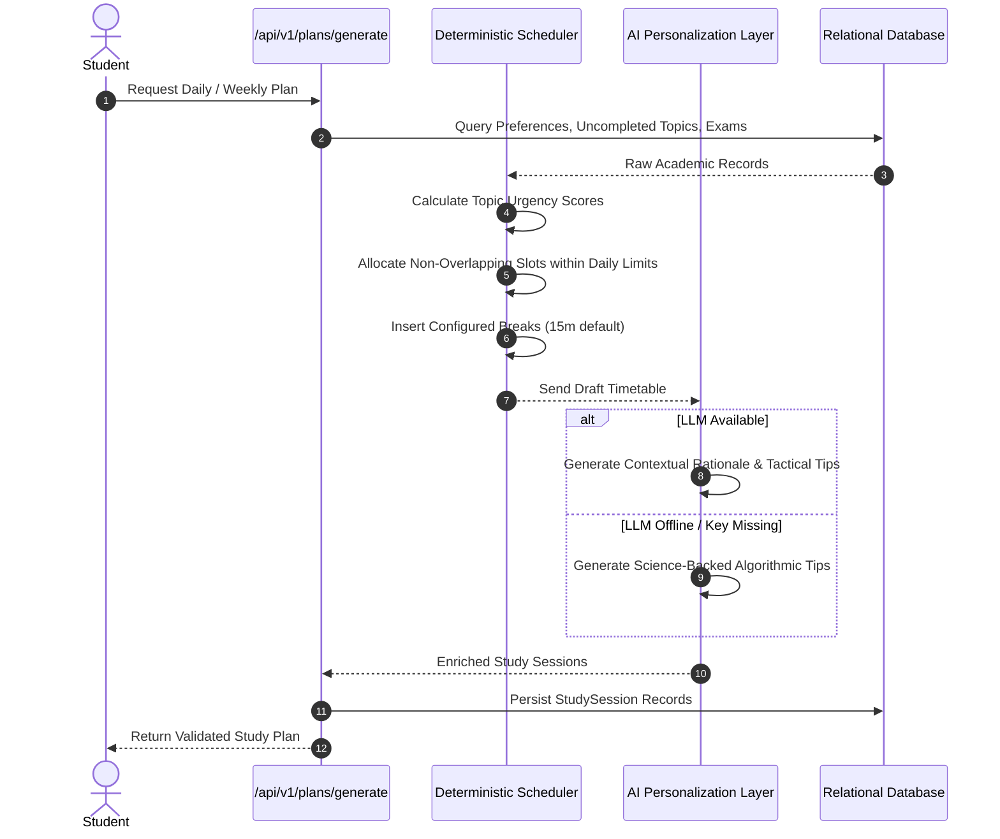

# System Architecture & Technical Design

## 1. Executive Overview

**AI Study Planner** is an intelligent academic productivity platform that combines a **deterministic constraint-based scheduling engine** with **Large Language Model (LLM) personalization**. Rather than relying on simple static timetables or unconstrained LLM hallucinations, the platform uses a hybrid architectural pattern:

1. **Deterministic Core:** Rigorously calculates topic urgency, upcoming exam proximity, daily hour limits, non-overlapping time intervals, and rest breaks.
2. **AI Personalization Layer:** Enriches schedules with tactical cognitive learning tips, generates context-aware conceptual guidance, and synthesizes dynamic quizzes.
3. **Adaptive Feedback Loop:** Re-evaluates upcoming plans when students mark sessions as partially completed or skipped, redistributing tasks without violating maximum daily capacity.

---

## 2. System Architecture Diagram

```mermaid
graph TD
    subgraph Client [Frontend - React + Vite + Tailwind CSS]
        UI[SaaS Dashboard UI]
        Router[React Router DOM]
        State[Auth & Theme Context]
        Charts[Recharts Data Visualizations]
        APIClient[Axios Client with JWT Interceptor]
    end

    subgraph Server [Backend - FastAPI & Python 3.13]
        Gateway[FastAPI Application Gateway /api/v1]
        AuthMid[JWT Authentication & Password Hash Security]
        SchedulerDaemon[APScheduler Notification Daemon]
        
        subgraph Services [Service Layer]
            PlannerEngine[Planner Service (Deterministic Constraint Engine)]
            AdaptiveEngine[Adaptive Service (Dynamic Rebalancing)]
            QuizEngine[Quiz Service (MCQ Generation & Grading)]
            RevisionEngine[Spaced Revision Service (1-3-7-14 Days)]
            AIEngine[AI Service Layer (OpenAI + Intelligent Fallback)]
        end
    end

    subgraph Data [Storage Layer]
        SQLite[(SQLite / PostgreSQL Relational DB)]
        ORM[SQLAlchemy ORM Models]
    end

    subgraph External [AI Providers]
        OpenAI[OpenAI API (gpt-4o-mini)]
    end

    UI --> APIClient
    APIClient -->|REST + Bearer Token| Gateway
    Gateway --> AuthMid
    AuthMid --> Services
    PlannerEngine --> ORM
    AdaptiveEngine --> ORM
    QuizEngine --> ORM
    RevisionEngine --> ORM
    ORM --> SQLite
    AIEngine --> OpenAI
    SchedulerDaemon -->|Periodic Checks| ORM
```

---

## 3. The Hybrid Scheduling Engine

The application separates mathematical scheduling from generative intelligence:



### Urgency Formula

$$\text{Urgency Score} = W_{\text{difficulty}} + W_{\text{revision}} + W_{\text{exam}} + W_{\text{subject\_priority}} + W_{\text{continuation}}$$

Where:
- $W_{\text{difficulty}}$: Hard (+25), Medium (+15), Easy (+5)
- $W_{\text{revision}}$: Revision Required (+30)
- $W_{\text{exam}}$:
  - $\le 3\text{ days}$: +60
  - $\le 7\text{ days}$: +40
  - $\le 14\text{ days}$: +25
  - $\le 30\text{ days}$: +15
- $W_{\text{subject\_priority}}$: High or Urgent (+15)
- $W_{\text{continuation}}$: In-progress topic (+10)

---

## 4. Spaced Revision & Adaptive Loop

When a session is marked as completed:
1. Topic `actual_time_spent_minutes` increments.
2. If completion percentage reaches 100%, `RevisionSchedule` Step 1 (1 day later) is scheduled.
3. Completing Step 1 triggers Step 2 (3 days later), Step 3 (7 days later), and Step 4 (14 days later).
4. If a quiz score on a topic drops below 70%, the topic is automatically re-flagged with `revision_required = True`.

